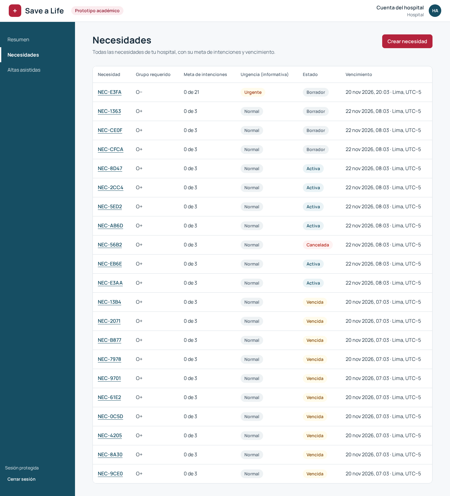
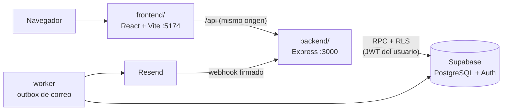

# 🩸 Save a Life

[](https://github.com/DiegoRomanP/Safe-a-Life/actions/workflows/ci.yml)
[](https://github.com/DiegoRomanP/Safe-a-Life/actions/workflows/security.yml)


[](LICENSE)

**Coordina a hospitales autorizados de Lima con donantes de sangre voluntarios, sin
contacto directo entre paciente y donante.** El hospital publica una necesidad, el
sistema invita a donantes compatibles por correo y el hospital ve quién confirmó su
intención de acudir.

> ⚠️ **Prototipo académico.** Solo usa datos sintéticos (`*.example.test`). Una
> confirmación es una intención, no una donación ni una evaluación clínica. Antes de
> tratar datos reales hace falta una revisión clínica, legal y de privacidad aplicable
> en Perú. Este repositorio no afirma cumplimiento legal ni clínico.

<picture>
  <source media="(prefers-color-scheme: dark)" srcset="docs/assets/readme/hospital-necesidades-oscuro.png">
  
</picture>

## 🚀 Quick Start

Requiere **Node 24.19.0** y **npm 12.0.2** (`nvm use` lee `.nvmrc`). La demo no
necesita secretos ni base de datos.

```bash
git clone https://github.com/DiegoRomanP/Safe-a-Life.git && cd Safe-a-Life
nvm use
SCARF_ANALYTICS=false npm ci
npm run dev
```

Abre <http://127.0.0.1:5173>: es la demo web contra un mock con estado sintético en
memoria. Para el sistema real (backend + Supabase + frontend), ver la sección
**🛠️ Ejecutar con el backend real** más abajo.

## ⚡ Features

- ✅ **Tres roles:** donante, administrador de hospital y superadmin.
- ✅ **Donante:** registro con verificación de correo, perfil obligatorio,
  disponibilidad y ubicación, invitaciones, historial y solicitudes de privacidad
  (corrección o eliminación).
- ✅ **Hospital:** necesidades con urgencia y vencimiento, lotes de invitación,
  respuestas (solo ve el nombre de quien confirmó) y altas asistidas.
- ✅ **Superadmin:** hospitales, sedes, administradores, auditoría y cola de tareas.
- ✅ **Correo con outbox y worker** (Resend detrás de un adaptador), webhook firmado y
  enlaces de respuesta de un solo uso.
- 🔒 **Seguridad:** cookies `__Host-`, CSRF con `Origin` + HMAC, MFA (TOTP) y step-up,
  JWT verificados con JWKS en caché, RLS en todas las tablas y límites de peticiones.
- 📜 **Contract-first:** un único contrato OpenAPI 3.1 del que se generan los tipos y
  validadores del backend, la web y el mock.
- 🎨 **UI accesible:** contraste WCAG AA, modo oscuro automático y diseño responsive.

## 🧱 Arquitectura



| Carpeta | Qué es |
| :--- | :--- |
| `backend/` | Monolito modular Express (producción). Módulos en `src/modules/`, cada uno con `domain`, `application`, `http` e `infrastructure`. Migraciones, seed y pgTAP en `backend/supabase/`. |
| `frontend/` | Frontend real (`@save-a-life/frontend`) conectado al backend. Ver [`frontend/README.md`](frontend/README.md). |
| `apps/web` + `apps/mock-api` | Demo web contra un mock Express. Su auth, CSRF y permisos son demostraciones. |
| `docs/` | Contrato OpenAPI, ADR, especificaciones y planes por tarea. |
| `bruno/` | Colección Bruno y escenarios sintéticos por rol. |

**Stack:** React 18, Tailwind 4, Vite, Node.js + Express, Supabase (PostgreSQL + Auth)
y Resend ([ADR-001](docs/decisions/ADR-001-stack-del-prototipo.md),
[ADR-002](docs/decisions/ADR-002-design-first-mock-tooling.md)).

**Reglas de persistencia** (ADR-003 y ADR-006, en [`docs/decisions/`](docs/decisions/)):

- Cada comando atómico es una función PostgreSQL llamada por RPC, con el JWT del usuario
  y RLS.
- `service_role` solo se usa según la allowlist de ADR-006.
- El rol y el hospital se resuelven desde datos protegidos, nunca desde el cliente.

## 🛠️ Ejecutar con el backend real

Requiere además Docker, la [Supabase CLI](https://supabase.com/docs/guides/local-development)
y Bruno CLI `4.2.0` en el `PATH` (para las pruebas Bruno).

**Opción rápida:** un solo comando recorre el sistema completo con los tres roles en
Chromium.

```bash
supabase start --workdir backend
npm run test:e2e:real
```

Este comando:

- reinicia la base **local** (nunca la remota) y siembra cuentas sintéticas;
- levanta el backend, el worker (con buzón local en `backend/.dev-mailbox`) y el
  frontend;
- registra un donante, crea una necesidad y un lote, y confirma desde el enlace del
  correo.

Variables útiles: `E2E_HEADED=1` (ver el navegador), `E2E_SHOTS=<dir>` (capturas) y
`E2E_CHROMIUM=<ruta>` (otro Chromium). Si falta el navegador:
`npx playwright install chromium`.

**Manual:** copia `backend/.env.example` a `backend/.env` y complétalo. Los valores de
Supabase local salen de `supabase status --workdir backend`. `ALLOWED_ORIGINS` debe
incluir `http://127.0.0.1:5174`. Después, en tres terminales:

```bash
npm run dev:backend    # API en :3000
npm run dev:worker     # outbox de correo (proceso aparte)
npm run dev:frontend   # frontend en :5174, con proxy de /api y /health al backend
```

> `npm ci` respeta la política `allowScripts` de ADR-002: no habilites scripts de
> instalación globalmente ni ejecutes `npm install` dentro de un workspace. El único
> lockfile es el `package-lock.json` raíz.

## 🧪 Verificación

```bash
npm test                         # Vitest en todos los workspaces
npm run lint                     # ESLint 9 + tsc --noEmit
npm run typecheck
npm run build
npm run test:backend:db          # pgTAP (requiere `supabase start --workdir backend`)
npm run test:backend:integration # integración contra Supabase local (reinicia y siembra)
npm run test:bruno:backend       # Bruno CLI contra el backend real
npm run test:e2e:real            # E2E de 3 roles contra el backend real
npm run audit:production         # npm audit sin dependencias de desarrollo
```

Contrato, mock y demo:

```bash
npm run openapi:lint
npm run openapi:types            # regenera tipos y validadores desde docs/openapi.json
npm run openapi:api:check        # falla si los artefactos generados se desviaron
npm run test:api:generator       # pruebas del generador OpenAPI
npm run test:backend:dto         # validadores DTO del backend
npm run test:api                 # integración del mock con Supertest
npm run test:contract            # runner Prism + Ajv2020 contra el contrato estático
npm run test:bruno               # escenarios Bruno contra el mock (puerto efímero)
npm run mock:prism               # mock estático del contrato en :4010
npm run test:e2e -- --trace=off  # Playwright de la demo; detén `npm run dev` antes
```

Solo los endpoints del backend real verificados con Bruno CLI cuentan como evidencia
del backend; Prism y el mock no. Los conteos de pruebas de cada ejecución quedan en el
plan de la tarea (`docs/plans/`). No compartas trazas, HAR, cabeceras, cookies ni
cuerpos de petición.

## 📖 Docs / API

La documentación vive en `docs/` y se publica como sitio con [VitePress](https://vitepress.dev):

```bash
npm run docs:dev      # servidor local con recarga
```

| Documento | Para qué |
| :--- | :--- |
| [`docs/README.md`](docs/README.md) | Índice por libros: producto, ADR, API, backend, frontend, proceso, diagramas, operación y pendientes. |
| [`docs/openapi.json`](docs/openapi.json) | Contrato canónico OpenAPI 3.1 (58 paths, 73 operaciones; 66 ratificadas, marcadas con `x-ratification`). |
| [`docs/Backend-Contracts.md`](docs/Backend-Contracts.md) | Alcance ratificado por operación y estado por módulo. |
| [`docs/Api-Rules.md`](docs/Api-Rules.md) | Reglas de contrato, seguridad, validación y consulta. |
| [`docs/Frontend-Handoff.md`](docs/Frontend-Handoff.md) | Setup, sincronización JSON → tipos → Bruno y matriz de operaciones. |
| [`docs/Frontend-Design.md`](docs/Frontend-Design.md) | Dirección visual (Penpot) e inventario de rutas. |
| [`docs/decisions/`](docs/decisions/) | ADR-001 a ADR-006. |
| [`docs/1_Primeros_Alcances.md`](docs/1_Primeros_Alcances.md) · [`docs/2_Especificaciones_De_Software.md`](docs/2_Especificaciones_De_Software.md) · [`Save_a_Life.xlsx`](Save_a_Life.xlsx) | Línea base funcional, ERS en borrador y requisitos. |
| [`evidence_pc2/diagramas_uml.md`](evidence_pc2/diagramas_uml.md) | Diagramas UML (editable en `evidence_pc2/diagramas/save-a-life-uml.drawio`). |

**Contrato:** solo se edita `docs/openapi.json`; después se ejecutan `openapi:lint`,
`openapi:types` y las pruebas de contrato y Bruno. Los archivos generados no se editan
a mano. Implementar una operación en borrador o cambiar una decisión abierta requiere
aprobación explícita.

### Límites de la demo (mock)

- Solo acepta correos `.example.test` y datos sintéticos en RAM; no se conecta a
  Supabase, Resend ni mapas, y no envía correos.
- Su cookie, CSRF, AAL2 y permisos no prueban autenticación, autorización ni RLS
  productivas.
- Crear una necesidad la deja en borrador; no ejecuta matching ni crea lotes. Un lote
  manual se registra con cero invitaciones.
- Solo los lotes tienen cursor completo; las otras colecciones devuelven
  `nextCursor: null`.
- `/__mock/reset` solo existe en local, exige `Origin` local y una capacidad efímera, y
  no forma parte de OpenAPI.
- No se piden ni guardan historial ni fecha de donación, y no se muestran pacientes,
  diagnósticos ni historias clínicas.

## 🤝 Contributing

- Lee [`AGENTS.md`](AGENTS.md) (reglas vinculantes: privacidad, límites clínicos,
  stack, Definition of Done y gates de revisión) y [`CLAUDE.md`](CLAUDE.md).
- **Commits:** Conventional Commits, un commit atómico por unidad verificada. Añade
  solo tus archivos, nunca `git add -A`.
- **Datos:** solo sintéticos, con correos `.example.test`.
- **Planes:** registra cada tarea en `docs/plans/YYYY-MM-DD-<slug>.md` sin sobrescribir
  los de otras tareas.
- **Agentes (OpenCode y Claude Code):** los roles, skills y referencias viven en
  `.opencode/`; [`docs/Agent-Workflow.md`](docs/Agent-Workflow.md) define qué agente
  usar según dominio y riesgo, los gates de revisión y el registro por tarea.

## 📄 Licencia

[MIT](LICENSE) © 2026 DiegoRomanP
