# Diagramas UML de la arquitectura y de los patrones — Save a Life

Fecha: 2026-10-16. Este documento acompaña a
[`justificacion_arquitectura_patron.md`](justificacion_arquitectura_patron.md): allí se
justifica la arquitectura y aquí se dibuja.

- **Fuente editable:** [`diagramas/save-a-life-uml.drawio`](diagramas/save-a-life-uml.drawio),
  con una página por diagrama. Se abre con draw.io (escritorio o app.diagrams.net).
- **Imágenes:** `diagramas/png/`, exportadas desde ese mismo archivo.
- Todos los nombres de funciones, interfaces, RPC y tablas existen en el código. Las rutas que
  se citan son relativas a la raíz del repositorio.

## Índice

| Parte | Página | Diagrama | Tipo UML |
|---|---|---|---|
| — | 00 | [Leyenda y convención](#00-leyenda-y-convención) | — |
| A. Arquitectura | 01 | [Vista de despliegue](#01-vista-de-despliegue) | Despliegue |
| | 02 | [Monolito modular](#02-monolito-modular) | Componentes |
| | 03 | [Hexagonal dentro de un módulo](#03-arquitectura-hexagonal-dentro-de-un-módulo) | Paquetes / componentes |
| | 04 | [Contract-first](#04-contract-first) | Actividad |
| | 05 | [Persistencia segura](#05-persistencia-segura) | Paquetes |
| | 06 | [Crear una necesidad](#06-secuencia-crear-una-necesidad) | Secuencia |
| | 07 | [Envío de email](#07-secuencia-envío-de-email-y-webhook) | Secuencia |
| B. Patrones | 10 | [Puertos y adaptadores + DIP + composition root](#10-puertos-y-adaptadores--inversión-de-dependencias--composition-root) | Clases |
| | 11 | [Capa anticorrupción + unión discriminada](#11-gateway--capa-anticorrupción--unión-discriminada) | Clases |
| | 12 | [Strategy + LSP](#12-strategy-y-sustitución-de-liskov) | Clases |
| | 13 | [Registro de plantillas (OCP)](#13-registro-de-plantillas-principio-abiertocerrado) | Clases |
| | 14 | [Chain of Responsibility](#14-chain-of-responsibility) | Clases + actividad |
| | 15 | [Máquina de estados](#15-máquina-de-estados-de-una-necesidad) | Estados |
| | 16 | [Transactional outbox + reintentos](#16-transactional-outbox--política-de-reintentos) | Clases + estados |
| | 17 | [Idempotencia + cursor firmado](#17-clave-de-idempotencia-y-cursor-firmado) | Secuencia |
| | 18 | [Segregación de interfaces](#18-segregación-de-interfaces-isp) | Clases |

Los "dobles de prueba de sistema" (mock, Prism, Bruno) aparecen en la página 01. El
"vencimiento calculado al leer" aparece en la página 15.

---

## 00. Leyenda y convención

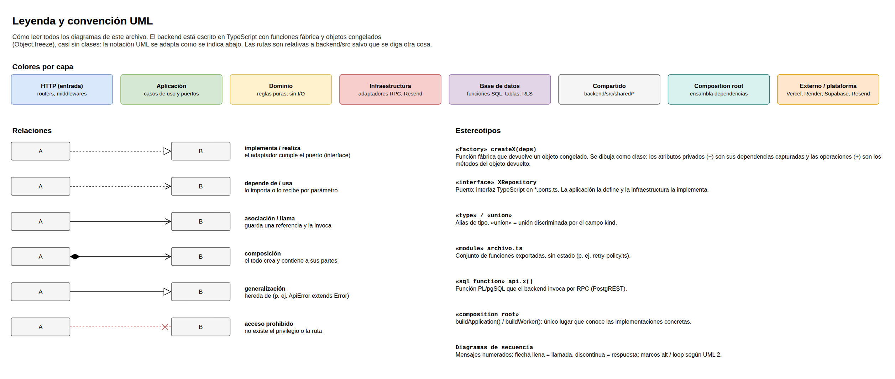

El backend usa casi siempre **funciones fábrica** (`createX(deps)`) que devuelven un objeto
congelado, en lugar de clases. Para poder dibujarlo en UML se usa esta convención:

- **`«factory» createX(deps)` se dibuja como una clase.** Los atributos privados (`-`) son las
  dependencias que la función captura en su cierre; las operaciones (`+`) son los métodos del
  objeto que devuelve.
- **`«interface»`** es un puerto definido en un `*.ports.ts`.
- **`«union»`** es una unión discriminada por el campo `kind`.
- **`«sql function»`** es una función PL/pgSQL que el backend invoca por RPC.
- **Colores por capa**, iguales en todas las páginas: azul = HTTP, verde = aplicación,
  amarillo = dominio, rojo = infraestructura, morado = base de datos, gris = `shared/`,
  turquesa = composition root, naranja = externo.

---

## Parte A — Arquitectura

### 01. Vista de despliegue

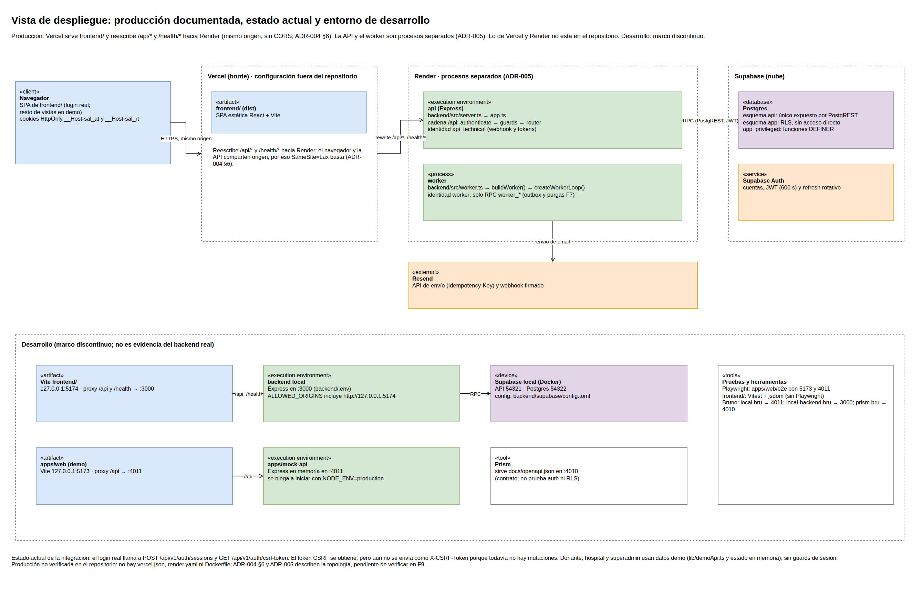

**Qué muestra.** Dónde corre cada pieza en producción y en desarrollo.

**Cómo leerlo.**
- **Producción:** Vercel sirve el frontend y reescribe `/api/*` y `/health/*` hacia Render. Así
  el navegador y la API comparten origen: basta `SameSite=Lax` y no hace falta CORS (ADR-004).
- **Procesos:** en Render corren dos procesos separados, la API Express y el worker de email.
  Cada uno tiene su propia identidad técnica (ADR-005).
- **Datos:** viven en Supabase. PostgREST expone solo el esquema `api`.
- **Desarrollo (marco discontinuo):** contiene el mock, Prism, Bruno y Playwright. No es
  evidencia del backend real.

**Caso en el código.** La cadena de middlewares está en `backend/src/app.ts:67`; las raíces de
composición están en `backend/src/composition.ts:59` y `backend/src/composition-worker.ts`.

### 02. Monolito modular

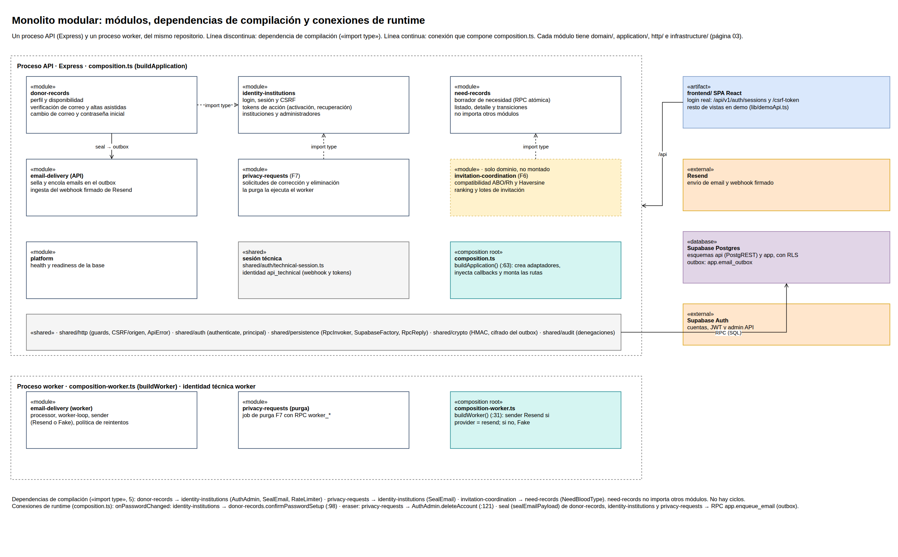

**Qué muestra.** Los cinco módulos de negocio, `shared/` y las dependencias reales entre
ellos.

**Cómo leerlo.**
- **Único import entre módulos:** `donor-records` importa puertos de `identity-institutions`.
- **El resto de la comunicación** es por funciones que `composition.ts` inyecta:
  - `seal` para escribir en el outbox de `email-delivery`;
  - `onPasswordChanged` para que `action-tokens` avise a `donor-records`
    (`backend/src/composition.ts:94`).

Así no hay ciclos de import.

### 03. Arquitectura hexagonal dentro de un módulo

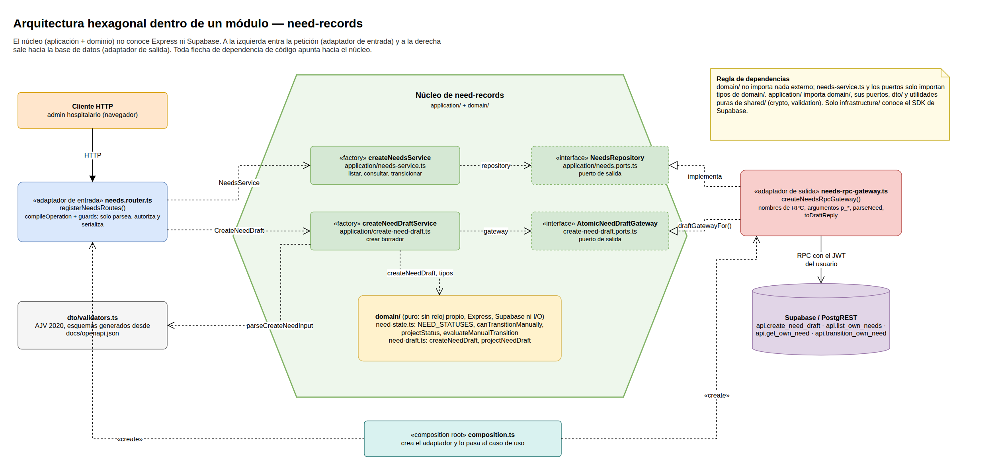

**Qué muestra.** Las capas de `need-records`.

**Cómo leerlo.** El hexágono es el núcleo, formado por la aplicación y el dominio.

- **A la izquierda**, el adaptador de entrada (`needs.router.ts`) recibe HTTP.
- **A la derecha**, el adaptador de salida (`needs-rpc-gateway.ts`) habla con Supabase.
- **Dentro del núcleo**, los puertos de salida (`NeedsRepository`, `AtomicNeedDraftGateway`)
  son interfaces que la aplicación define.
- **Dirección de las flechas:** las flechas "implementa" van del adaptador hacia el puerto, es
  decir, hacia dentro. Esa es la regla de dependencias.

### 04. Contract-first

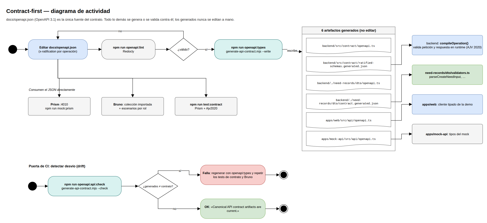

**Qué muestra.** El flujo de trabajo con el contrato. Solo `docs/openapi.json` se edita a mano.

**Cómo leerlo.**
1. Se edita el JSON y se valida con `npm run openapi:lint`.
2. `npm run openapi:types` genera seis artefactos. Los consumen `compileOperation` (validación
   de petición y respuesta en runtime), los validadores DTO, la web y el mock.
3. Prism, Bruno y `test:contract` leen el JSON directamente.
4. `npm run openapi:api:check` falla si un generado se desvía del contrato.

### 05. Persistencia segura

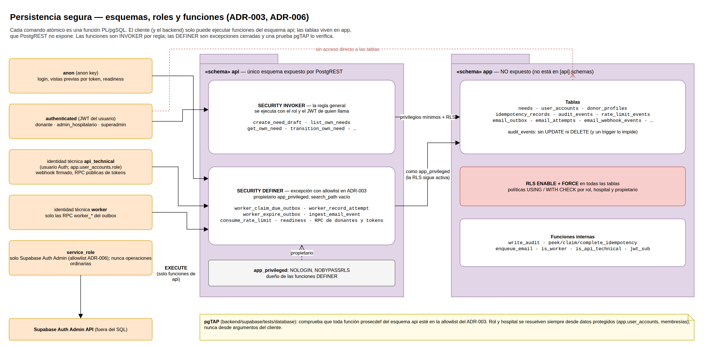

**Qué muestra.** Cómo se aplica ADR-003 (RPC, INVOKER por regla) y ADR-006 (`service_role`
restringido).

**Cómo leerlo.**
- Los roles de la izquierda solo pueden hacer `EXECUTE` sobre funciones del esquema `api`.
- La flecha roja marca que nadie accede directo a las tablas de `app`.
- Las funciones INVOKER corren con el JWT de quien llama, más la RLS.
- Las funciones DEFINER son excepciones listadas en el ADR. Pertenecen a `app_privileged`, un
  rol sin login y sin `BYPASSRLS`.
- Una prueba pgTAP comprueba la lista de funciones DEFINER.

**Caso en el código.** `api.create_need_draft` en
`backend/supabase/migrations/20261013030000_need_records.sql:103`.

### 06. Secuencia: crear una necesidad

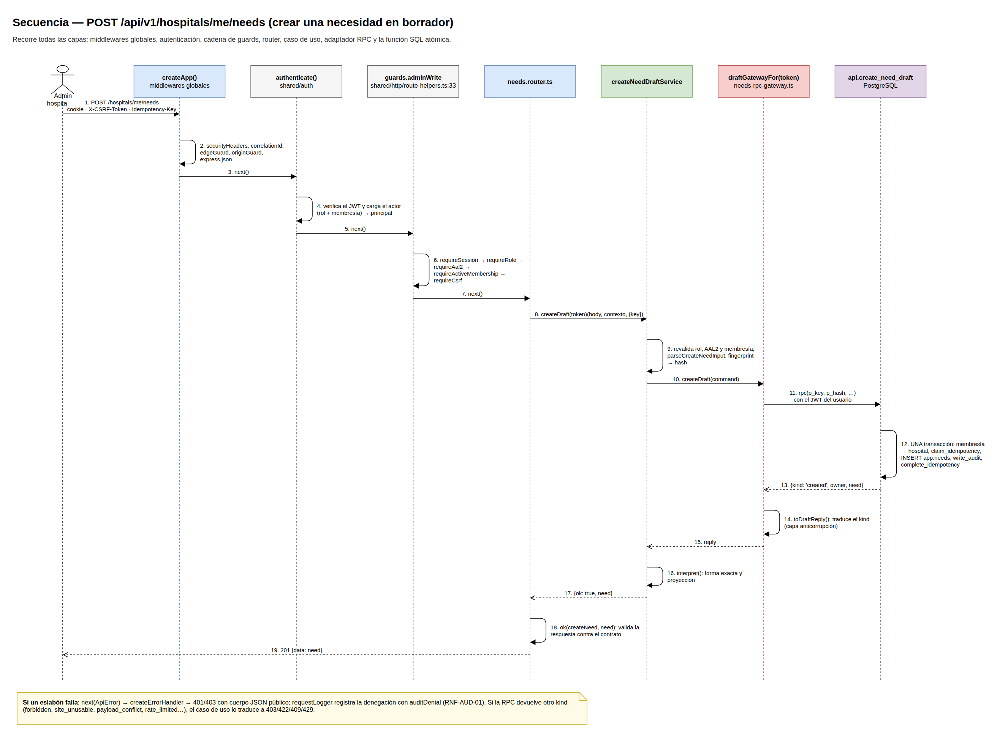

**Qué muestra.** El recorrido completo de `POST /api/v1/hospitals/me/needs`.

**Cómo leerlo.**
- **Mensajes 1–7:** middlewares, autenticación y cadena de guards (patrón de la página 14).
- **Mensajes 8–10:** caso de uso. Revalida permisos y calcula el hash de idempotencia.
- **Mensajes 11–12:** una única RPC atómica. Dentro de una sola transacción hace idempotencia,
  inserta la necesidad y escribe la auditoría.
- **Mensajes 13–19:** la respuesta pasa por la capa anticorrupción (`toDraftReply`) y se
  valida contra el contrato antes de enviarla.

**Caso en el código.**
- Router: `backend/src/modules/need-records/http/needs.router.ts:54`.
- Caso de uso: `backend/src/modules/need-records/application/create-need-draft.ts:93`.

### 07. Secuencia: envío de email y webhook

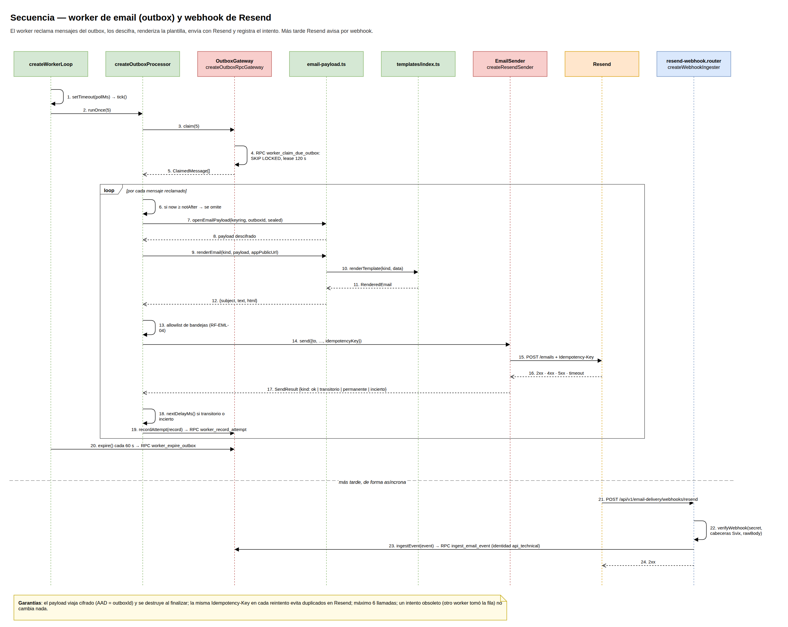

**Qué muestra.** Un ciclo del worker y la llegada posterior del webhook.

**Cómo leerlo.**
- **Marco `loop`:** el procesamiento de cada mensaje reclamado. Lo descifra, renderiza la
  plantilla, aplica la allowlist de bandejas, lo envía con la misma `Idempotency-Key` y
  registra el intento.
- **Bajo la línea "más tarde":** Resend llama al webhook firmado. La API lo verifica y registra
  el evento con la identidad `api_technical`, no con la del worker.

---

## Parte B — Patrones

Cada sección sigue el mismo orden: primero **el caso en el código** (dónde aparece el patrón),
luego **el diagrama** con la interacción entre los participantes y, al final, la **tabla de
roles** del patrón.

### 10. Puertos y adaptadores + inversión de dependencias + composition root

**Caso en el código.**
- `createNeedsService(repository: NeedsRepository)`
  (`backend/src/modules/need-records/application/needs-service.ts:10`) recibe una interfaz
  definida en la propia aplicación (`needs.ports.ts:27`).
- La implementación concreta es `createNeedsRpcGateway` (`needs-rpc-gateway.ts:66`).
- Solo `buildApplication` (`backend/src/composition.ts:64`) conecta ambas partes.

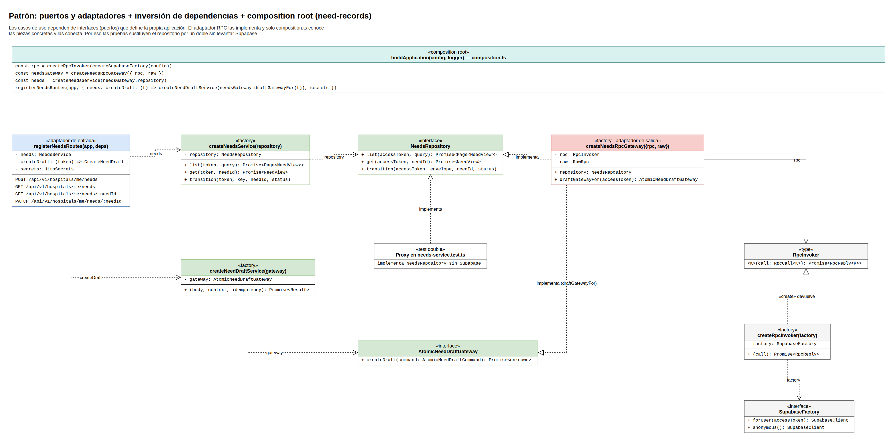

| Rol | Participante |
|---|---|
| Puerto de salida | `«interface» NeedsRepository`, `«interface» AtomicNeedDraftGateway` |
| Caso de uso (depende de la abstracción) | `createNeedsService`, `createNeedDraftService` |
| Adaptador de salida | `createNeedsRpcGateway` (usa `RpcInvoker` → `SupabaseFactory`) |
| Adaptador de entrada | `registerNeedsRoutes` |
| Composition root | `buildApplication` (`composition.ts`) |
| Doble de prueba | `Proxy` en `needs-service.test.ts`, que implementa `NeedsRepository` |

**Por qué está bien aplicado.** El caso de uso no importa Supabase. Cambiar de adaptador o
probar sin base de datos no obliga a tocar la aplicación (DIP).

### 11. Gateway + capa anticorrupción + unión discriminada

**Caso en el código.**
- `createRpcInvoker` (`backend/src/shared/persistence/rpc-invoker.ts:20`) llama a `callRpc`,
  valida la forma de la respuesta con `parseRpcReply` (`rpc-reply.ts:22`), desenvuelve los
  `replayed` y traduce los fallos con `mapFailureToApiError`.
- Cada proyección se valida con guards cerrados: `parseNeed` (`needs-rpc-gateway.ts:12`) usa
  `closedRecord` y `oneOf` (`guards.ts:11`).

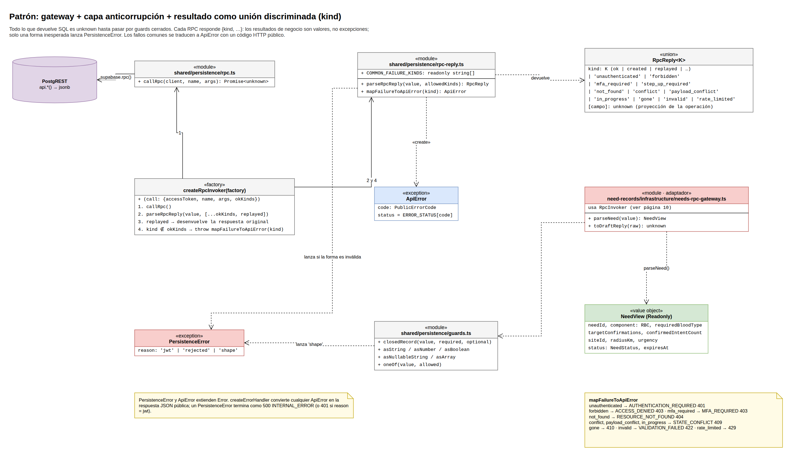

| Rol | Participante |
|---|---|
| Sistema externo | PostgREST (`api.*()` → `jsonb`) |
| Gateway | `createRpcInvoker`, `callRpc` |
| Traductor (capa anticorrupción) | `parseRpcReply`, `parseNeed`, `toDraftReply`, `guards.ts` |
| Resultado discriminado | `«union» RpcReply<K>` (`kind`) |
| Modelo propio | `NeedView` (inmutable) |
| Errores | `PersistenceError` (forma inválida), `ApiError` (fallo de negocio → HTTP) |

**Por qué está bien aplicado.** Un cambio en SQL que rompa la forma de la respuesta se detecta
en el borde (`PersistenceError('shape')`) y no se propaga como datos corruptos.

### 12. Strategy y sustitución de Liskov

**Caso en el código.**
- `createOutboxProcessor` (`backend/src/modules/email-delivery/application/process-outbox.ts:30`)
  solo conoce `EmailSender` (`email-sender.ts:19`).
- `buildWorker` elige la estrategia (`backend/src/composition-worker.ts:33`):
  `createResendSender` en producción y `FakeEmailSender` en local y en pruebas.

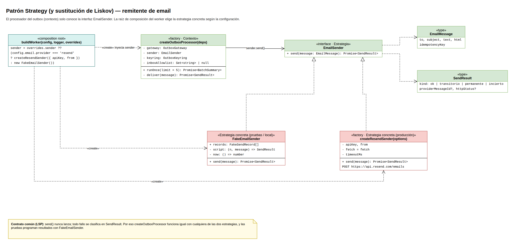

| Rol | Participante |
|---|---|
| Contexto | `createOutboxProcessor` |
| Estrategia | `«interface» EmailSender` |
| Estrategias concretas | `createResendSender` (`resend-sender.ts:60`), `FakeEmailSender` (`fake-sender.ts:9`) |
| Quien elige | `buildWorker` (composition root del worker) |

**LSP.** Ambas estrategias cumplen el mismo contrato de comportamiento: `send()` nunca lanza y
todo fallo se clasifica en `SendResult`. El contexto funciona igual con cualquiera de las dos.

### 13. Registro de plantillas (principio abierto/cerrado)

**Caso en el código.** `renderTemplate` no tiene `switch`: busca la función en la tabla
`RENDERERS` (`backend/src/modules/email-delivery/templates/index.ts:23`). El tipo mapeado
`[K in EmailKind]` obliga a que cada tipo de email tenga su renderer.

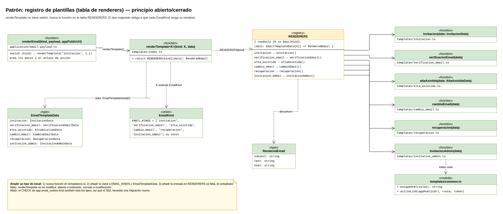

| Rol | Participante |
|---|---|
| Cliente | `renderEmail` (`email-payload.ts`) |
| Despachador | `renderTemplate<K>` |
| Registro | `RENDERERS` |
| Implementaciones | las 6 funciones de `templates/*.ts` |
| Contrato del producto | `RenderedEmail` (`subject`, `text`, `html`) |

**Matiz.** Añadir un tipo no modifica `renderTemplate`, pero sí exige una migración nueva: el
`CHECK` de `app.email_outbox.kind` también enumera los tipos.

### 14. Chain of Responsibility

**Caso en el código.** `guardsFor(secrets)` (`backend/src/shared/http/route-helpers.ts:20`)
compone cadenas de `RequestHandler`. Cada guard, por ejemplo `requireSession`
(`backend/src/shared/auth/guards.ts:8`) o `requireCsrf` (`csrf-guard.ts:13`), hace una de dos
cosas: llama a `next()` para pasar al siguiente, o corta la cadena con `next(ApiError)`.

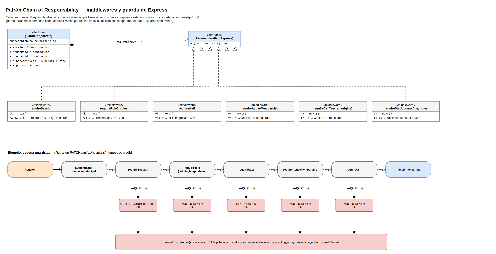

| Rol | Participante |
|---|---|
| Manejador (interfaz) | `RequestHandler` de Express |
| Manejadores concretos | `requireSession`, `requireRole`, `requireAal2`, `requireActiveMembership`, `requireCsrf`, `requireStepUp` |
| Ensamblador de cadenas | `guardsFor` (`adminWrite`, `donorRead`, …) |
| Fin de la cadena | handler de la ruta, o `createErrorHandler` si un eslabón corta |

**Por qué está bien aplicado.** El orden importa y está fijado en un solo sitio. Por ejemplo,
CSRF se comprueba antes que el step-up (ADR-004), y cada ruta declara su cadena con
`...guards.adminWrite`.

### 15. Máquina de estados de una necesidad

**Caso en el código.**
- La matriz C-8 está en `MANUAL_TRANSITIONS`
  (`backend/src/modules/need-records/domain/need-state.ts:11`).
- La decisión real la toma `api.transition_own_need`
  (`backend/supabase/migrations/20261013030000_need_records.sql:238`) bajo bloqueo de fila.
- `vencida` se proyecta al leer, tanto en TypeScript (`projectStatus`, `need-state.ts:40`)
  como en SQL (`20261013030000_need_records.sql:56`).

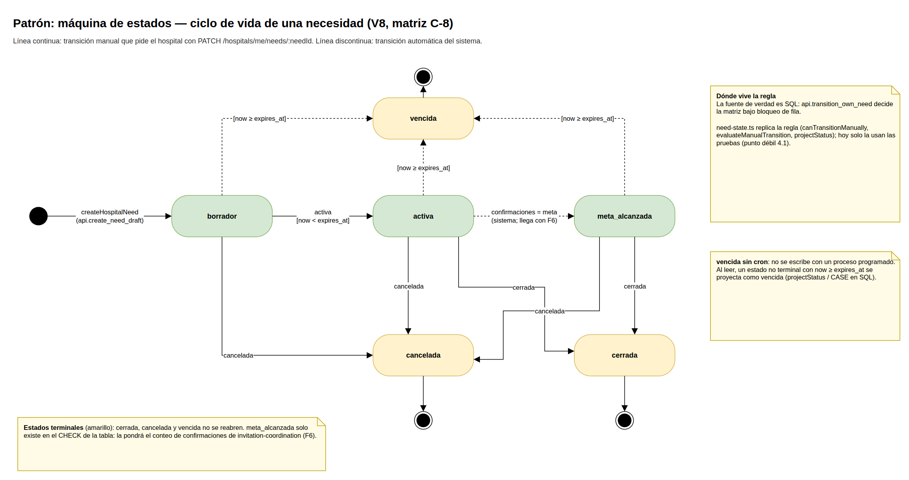

**Cómo leerlo.**
- **Línea continua:** transición que pide el hospital con `PATCH`.
- **Línea discontinua:** transición automática del sistema.
- **Estados en amarillo:** terminales; no se reabren.
- `meta_alcanzada` todavía no la escribe ningún código: llegará con
  `invitation-coordination` (F6).

**Punto débil (4.1 de la justificación).** La regla existe en TypeScript y en SQL. Hoy la
versión TypeScript solo la usan las pruebas.

### 16. Transactional outbox + política de reintentos

**Caso en el código.**
- **Productores:** los servicios de donantes y tokens sellan el payload con `sealEmailPayload`
  (`email-payload.ts:29`). La RPC de negocio lo encola con `app.enqueue_email`
  (`20261013040000_email_delivery.sql:113`) en la misma transacción.
- **Worker:** `createWorkerLoop` (`worker-loop.ts:19`) llama a `createOutboxProcessor`, que
  reclama con `api.worker_claim_due_outbox` (`email_delivery.sql:128`, `SKIP LOCKED`).
- **Reintentos:** aplica `retry-policy.ts:2` (`MAX_CALLS = 6`, backoff de 1, 2, 5, 10 y
  20 minutos).

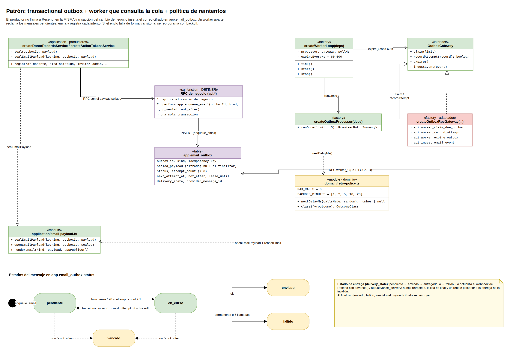

| Rol | Participante |
|---|---|
| Productor | `createDonorRecordsService`, `createActionTokensService` |
| Escritura atómica | RPC de negocio + `app.enqueue_email` → `app.email_outbox` |
| Consumidor que consulta la cola | `createWorkerLoop` → `createOutboxProcessor` |
| Puerto / adaptador | `OutboxGateway` / `createOutboxRpcGateway` (`outbox-rpc-gateway.ts:25`) |
| Política | `retry-policy.ts` (`nextDelayMs`, `classify`) |
| Estado de entrega | `advance()` (`delivery-state.ts:12`), que nunca retrocede |

**Cómo leer los estados.** `pendiente → en_curso` ocurre al reclamar. Desde `en_curso` el
mensaje pasa a `enviado` (ok), vuelve a `pendiente` con backoff (fallo transitorio o
incierto) o pasa a `fallido` (permanente o 6 llamadas). Desde `pendiente` o `en_curso` pasa a
`vencido` si se supera `not_after`.

### 17. Clave de idempotencia y cursor firmado

**Caso en el código.**
- **Idempotencia:** el caso de uso calcula `fingerprint` del cuerpo normalizado. La RPC llama
  a `peek`/`claim`/`complete_idempotency` sobre `app.idempotency_records`.
- **Paginación:** `decodeCursor` (`backend/src/shared/persistence/cursor.ts:28`) verifica el
  HMAC del cursor, ligado a `userId:operación`. `respondPage` (`route-helpers.ts:73`) firma el
  siguiente cursor.

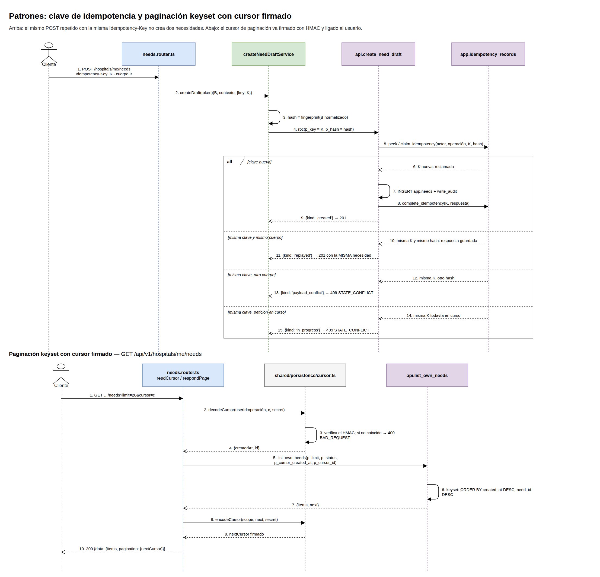

**Cómo leerlo.** El marco `alt` tiene cuatro ramas:

1. Clave nueva → crea la necesidad (201).
2. Misma clave y mismo cuerpo → devuelve la respuesta original sin duplicar (201).
3. Misma clave y otro cuerpo → 409.
4. Misma clave con una petición aún en curso → 409.

Abajo, la paginación es *keyset* (`ORDER BY created_at DESC, need_id DESC`), no `OFFSET`. Un
cursor manipulado se rechaza con 400.

### 18. Segregación de interfaces (ISP)

**Caso en el código.** `DonorRecordsRepository`
(`backend/src/modules/donor-records/application/donor-records.ports.ts:59`) declara 20
métodos, y `createDonorRecordsService` depende de todos.

En cambio, `createActionTokensService` sí está bien segregado: no recibe el repositorio, solo
la función `onPasswordChanged` (`backend/src/composition.ts:94`).

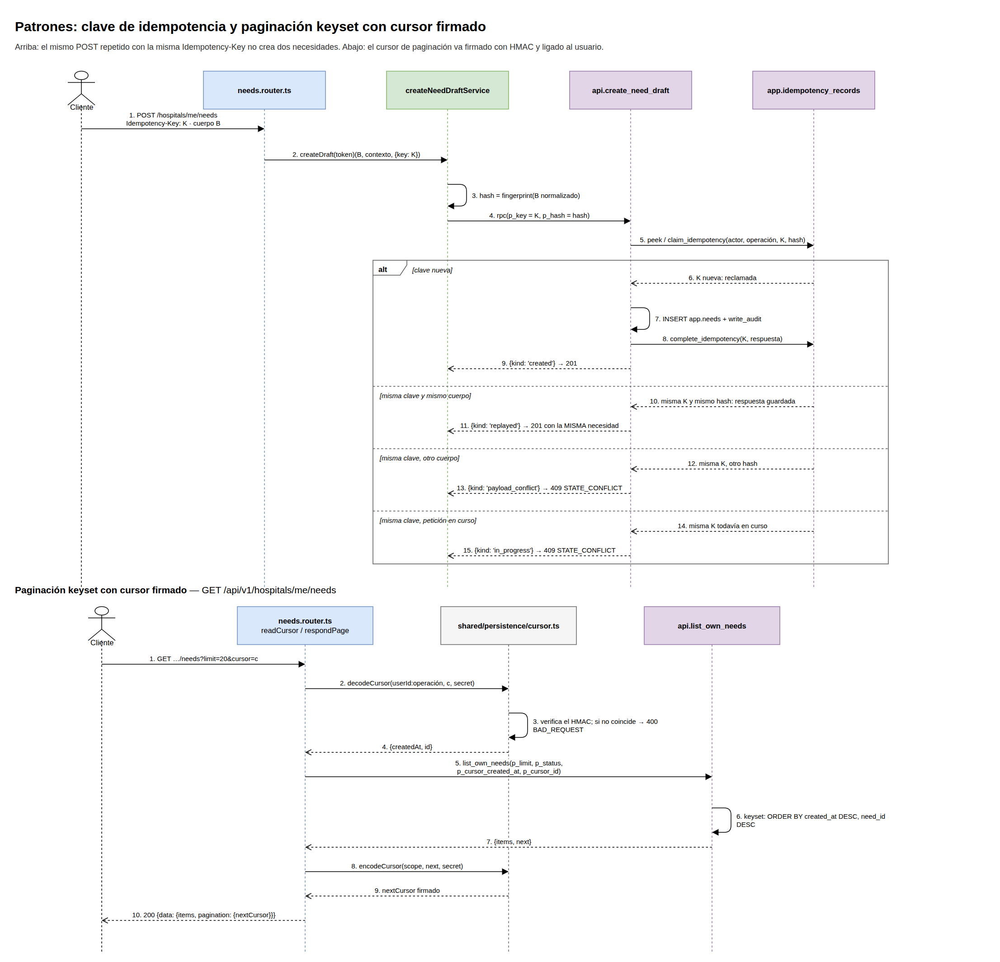

**Propuesta (no implementada).** Partir el puerto en cinco interfaces por caso de uso. El
mismo adaptador las implementa todas y no cambia ni una RPC.

---


## Parte C — Diagramas de clases y conexiones

Verificados contra `backend/src` y `backend/src/composition.ts`.

| Página | Contenido | Imagen |
|---|---|---|
| 20 | Modelo de dominio (tipos y reglas puras) | `diagramas/png/20-clases-dominio.png` |
| 21 | Clases: need-records | `diagramas/png/21-clases-need-records.png` |
| 22 | Clases: donor-records | `diagramas/png/22-clases-donor-records.png` |
| 23 | Clases: identity-institutions | `diagramas/png/23-clases-identity-institutions.png` |
| 24 | Clases: email-delivery | `diagramas/png/24-clases-email-delivery.png` |
| 25 | Clases: privacy-requests (invitation-coordination solo tiene dominio, página 20) | `diagramas/png/25-clases-privacy-requests.png` |
| 26 | Clases: shared (auth, http, persistencia, criptografía) | `diagramas/png/26-clases-shared.png` |
| 27 | Conexiones de composición (diagrama de objetos) | `diagramas/png/27-composicion.png` |

## Cómo regenerar las imágenes

Desde `docs/evidence_pc2/diagramas/`. Las páginas se numeran desde 1 en el CLI de draw.io:

```bash
drawio -x -f png -s 1.5 -b 20 -p 1 -o png/00-leyenda.png save-a-life-uml.drawio
```
